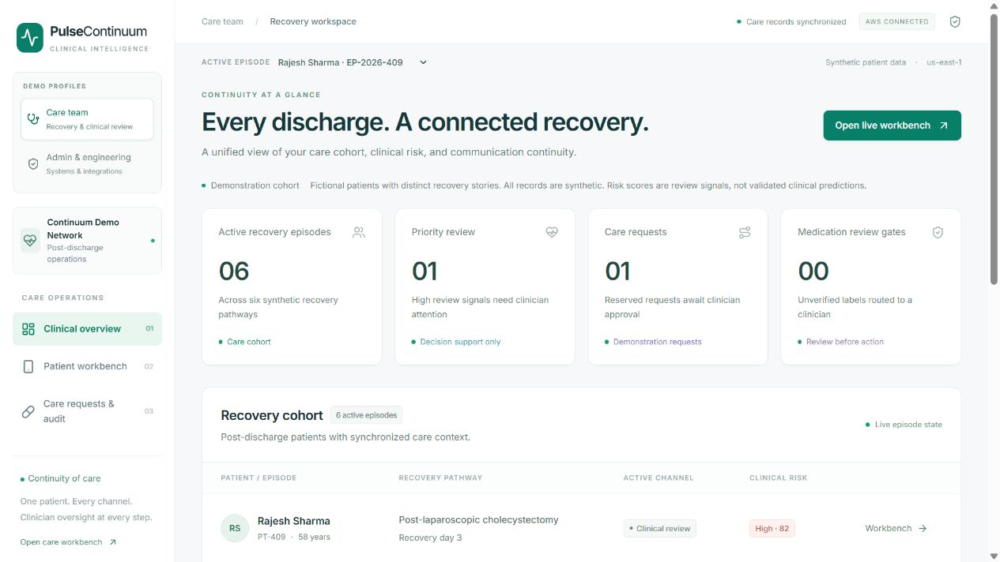
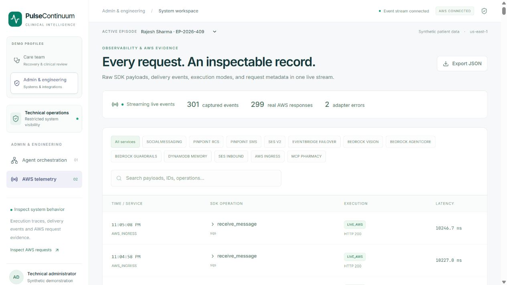
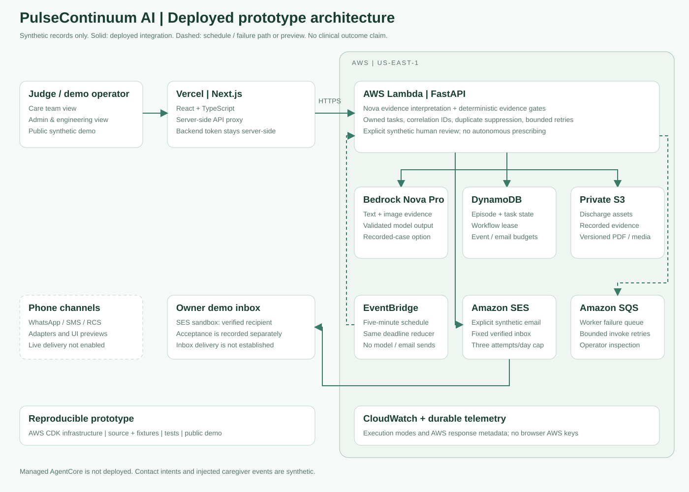

<div align="center">

# PulseContinuum AI

### One recovery episode. Every handoff. Context intact.

Post-discharge care continuity with multimodal evidence, caregiver fallback, and an inspectable clinical audit.

**Next.js · FastAPI · Amazon Bedrock · DynamoDB · S3 · Amazon SES · AWS CDK**

[Open hosted demo](https://pulsecontinuum.vercel.app) · [Run locally](#run-the-demo) · [Two profiles](#two-profiles-one-episode) · [Architecture](#architecture) · [Verification](#evidence-you-can-inspect) · [Recording script](submission/DEMO_SCRIPT.md)

</div>

---

## The problem: a delivered message is not a completed handoff

A patient leaves hospital with a medication plan. At home, they report a symptom, send a blurry label photo, or lose mobile data. A caregiver responds through another channel. The next person reviewing the case needs the entire recovery story—not a collection of disconnected messages.

**PulseContinuum keeps the discharge plan, patient evidence, delivery state, caregiver response, and review request attached to one episode.** Its purpose is to make the next handoff understandable and accountable.

This is a working AWS-connected hackathon prototype using **synthetic records only**. It is clinical decision support, with clinician review required before action.

## What makes the project different

- **Continuity is the unit of work.** A channel change preserves the same episode, medication context, caregiver identity, and audit history.
- **Evidence precedes action.** Medication color never establishes identity. A readable drug name and strength must match the written discharge formulary; otherwise the case goes to review.
- **A missing receipt has a workflow.** A 15-second watchdog demonstrates how a pending alert can move toward caregiver fallback without losing context.
- **The product serves two audiences deliberately.** Care teams see recovery work. Administrators inspect orchestration and AWS execution evidence in a separate profile.
- **Cloud claims are inspectable.** Real service request metadata, explicit execution modes, and an approved SES acceptance distinguish implemented AWS behavior from simulated adapters.

## Two profiles, one episode

| Profile | Designed for | Workspace |
| --- | --- | --- |
| **Care team — default** | Clinicians and care coordinators | Clinical overview, patient workbench, care requests and clinical audit |
| **Admin & engineering** | Technical administrators and demo reviewers | Agent orchestration, identity graph, execution traces and raw AWS telemetry |

In the local synthetic demo, use the **Demo profiles** selector to switch between the two perspectives. Switch to Admin & engineering to explain how the workflow runs, then return to Care team to continue the recovery story.

The separation extends to the server: the care profile cannot retrieve telemetry or the raw event stream, and clinical API responses omit raw traces and AWS identifiers. On a secured deployment, care credentials cannot elevate privileges through a profile cookie or forged role header. The local selector is explicitly a demo convenience, not a hospital identity system. See [access design](docs/ACCESS_PROFILES.md).

<details>
<summary><strong>See the two workspaces</strong></summary>

**Care team — recovery work and clinician review**



**Admin & engineering — system evidence and troubleshooting**



</details>

## Follow one recovery story

**Discharge plan → patient evidence → safety review → continuity fallback → clinician audit**

1. **Start with the written plan.** Select a synthetic case and ingest its discharge PDF. The parser accepts explicit physician medication rows instead of inventing prescriptions from an unsupported document.
2. **Review the patient's evidence.** Submit the case-specific symptom report and an optional synthetic medication-label image. Connected mode sends actual image bytes and text to Nova Pro; structured output must validate before use.
3. **Apply the safety gate.** Unreadable labels, unknown drugs or strength mismatches require clinical review. Model risk scores are advisory review signals, not validated predictions.
4. **Demonstrate continuity.** A delivery timeout or blackout moves the episode into the patient/caregiver fallback path. The interface distinguishes a preview from a real send.
5. **Close the handoff with evidence.** A caregiver response or care-option request creates an idempotent synthetic reservation pending clinician approval and a clinical audit packet with payload integrity evidence.

**Phone delivery is currently blocked by AWS account onboarding.** WhatsApp, RCS and SMS adapters exist, but connected-mode attempts are labeled `NOT_SENT`. The complete simulated phone flow is available in offline demo mode. Pharmacy inventory, copays, ETAs and appointments are fixtures.

## Evidence you can inspect

| Check | Verified result | Evidence |
| --- | --- | --- |
| Backend regression suite | **14 passed** | [Verification record](VERIFICATION.md) |
| Deterministic safety/schema evaluation | **19 / 19 passed** | [Cases and results](submission/evaluation-results.json) |
| Frontend | Production build, TypeScript and lint passed | [Verification record](VERIFICATION.md) |
| Judge/profile access | Anonymous access rejected; care/admin boundaries tested | [Executable check](tools/verify_judge_access.py) |
| Infrastructure | CDK synthesis passed; shared AWS integration stack deployed | [CDK source](infra/) |
| AWS execution | S3, DynamoDB, Bedrock, EventBridge and approved SES submission verified | [Sanitized request evidence](submission/aws-verification-summary.json) |

The offline safety score measures deterministic code and schema behavior. It does **not** measure model accuracy, clinical efficacy, readmission reduction or financial savings. SES acceptance is proof of API acceptance, not independently confirmed inbox delivery. Sanitized AWS evidence includes earlier executions; a read-only recheck does not invoke the model or send another email.

[CI workflow](.github/workflows/verify.yml) runs backend checks and the frontend build on GitHub. A configured workflow is not itself proof of a completed hosted run.

## Architecture



The Next.js server proxies clinical requests to FastAPI with a private backend token. The Python orchestrator applies deterministic evidence checks and invokes AWS adapters. DynamoDB stores episode state; S3 stores discharge assets. EventBridge, SNS, SQS and a delayed Lambda support the continuity-event infrastructure. SES supplies the verified email path.

The hosted Python orchestrator runs in AWS Lambda; the local launcher remains available. Two FastMCP tool servers expose the same tool implementations. **Managed AgentCore Runtime, Memory and Gateway are not deployed.** A managed Bedrock Guardrail is optional and currently unconfigured; the local formulary gate remains active. See [architecture and trust boundaries](submission/ARCHITECTURE.md).

## Hosted demo

Open **https://pulsecontinuum.vercel.app** and sign in with the private credentials supplied to judges. The admin account can switch between Care team and Admin & engineering; the care account cannot access technical pages. Credentials are never published in this repository.

The frontend is hosted on Vercel, with a bearer-protected AWS Lambda backend, DynamoDB episode state, private S3 artifacts and durable telemetry. The hosted demo allows ten Bedrock inference attempts per UTC day and disables all outbound messaging. Its clinical audit packet is generated and stored, but no additional email is sent. Synthetic episode reset is enabled for repeatable judging. See [hosting details](docs/HOSTED_DEPLOYMENT.md).

## Run the demo

**Requirements:** Python 3.11+, Node.js 20+, and npm. Verification in the development workspace used Python 3.13 and Node.js 22. Dependency installation requires internet access.

```bash
git clone https://github.com/varmaleena/PulseContinuum.git
cd PulseContinuum
chmod +x start_demo.sh
./start_demo.sh
```

Windows PowerShell:

```powershell
git clone https://github.com/varmaleena/PulseContinuum.git
cd PulseContinuum
.\start_demo.ps1
```

Open **[localhost:3000](http://localhost:3000)**. The backend runs at [localhost:8000](http://localhost:8000/docs). Launchers install dependencies, build the frontend, and start both servers. A fresh checkout defaults to offline demo mode; **no AWS account is needed to explore the simulated workflow**.

Start in **Care team**, open Patient workbench, choose **Rajesh Sharma / EP-2026-409**, and use the sample discharge plan. Use Admin & engineering to inspect the resulting trace. Reset is available in offline demo mode only. Read the [three-minute recording script](submission/DEMO_SCRIPT.md) for a guided presentation.

For separate terminals, API contracts, MCP tools and AWS configuration, use the [development guide](docs/DEVELOPMENT.md).

## Six synthetic cases with distinct recovery context

| Episode | Recovery pathway |
| --- | --- |
| EP-2026-409 | Gallbladder surgery recovery |
| EP-2026-412 | Cardiac stent recovery |
| EP-2026-418 | Knee replacement recovery |
| EP-2026-421 | Asthma follow-up |
| EP-2026-425 | Diabetic foot wound follow-up |
| EP-2026-429 | Heart-failure discharge follow-up |

Each fictional case includes history, allergies, discharge observations, a written medication plan, a caregiver relationship, follow-up context and a labeled discharge PDF. Phone identities use the fictional +1-202-555-01xx range. No real hospital records or patient identities were imported.

[Dataset](backend/sample_assets/synthetic_cohort.json) · [PDF fixture generator](tools/generate_synthetic_assets.py)

## Connect your own AWS environment

1. Review and synthesize the [CDK stack](infra/). Deployment creates billable resources; inspect the template and permissions first.
2. Configure the normal AWS credential provider chain. Never embed access keys in source, browser code or container images.
3. Copy the root [.env.example](.env.example) to `backend/.env`, or use [connect_aws.py](tools/connect_aws.py) with an already deployed stack. Configure the deployed table/bucket names and permitted service identities.
4. Set `AWS_MODE=live`, `ALLOW_DEMO_FALLBACK=false`, and a strong `API_TOKEN`. Copy [frontend/.env.example](frontend/.env.example) to `frontend/.env.local` and set the matching private `BACKEND_API_TOKEN`.
5. Enable only verified outbound channels and explicitly allowlisted recipients. Messaging subscription, registration, sender identity and supported test-device requirements must be completed separately.

Before exposing the frontend publicly, require authentication, use distinct care/admin credentials, serve HTTPS, and keep the backend private. Do not deploy with a local demo profile selector as the only access control. [Profile deployment instructions](docs/ACCESS_PROFILES.md)

## Reproduce the checks

```bash
python -m venv .venv
# Activate .venv for your platform
python -m pip install -r backend/requirements.txt
python -m pytest -q
python -m ruff check backend tools
python tools/evaluate_submission.py
cd frontend
npm ci
npm run build
```

With the backend running and the production frontend built:

```bash
python tools/verify_judge_access.py
```

The access check starts temporary local frontend servers and tests anonymous requests, valid profiles, forged role headers/cookies, cross-origin switching and fail-closed configuration. It sends no clinical messages and invokes no model.

## Scope and next steps

| Implemented | Still required for broader use |
| --- | --- |
| Five-page app and two profile experiences | Hospital SSO, tenant isolation and per-user permissions |
| Real AWS storage, inference, events and approved email evidence | Phone subscription/onboarding and handset verification |
| Explicit-form discharge parsing and entered transcripts | Robust document extraction and automatic speech recognition |
| Synthetic pharmacy requests and signed audit payloads | Real provider/ERP integration and clinical validation |
| Private S3-backed hosted PDF/media storage | Production retention and institutional access policies |

The hosted app is available at **https://pulsecontinuum.vercel.app** with private judge credentials. A recorded demo video remains pending. Clinical audit HMACs provide shared-secret payload integrity, not physician digital signatures. This prototype is not certified for clinical deployment and makes no compliance or measured outcome claim.

## Project map

```text
backend/       FastAPI, local orchestration, AWS adapters, MCP tools, tests
frontend/      Five Next.js pages, care/admin profiles, private API proxy
infra/         Python AWS CDK for shared integration infrastructure
docs/          Development guide and profile access design
submission/    Architecture, demo script, description and sanitized evidence
tools/         Synthetic fixtures, verification and safe source packaging
```

**Submission materials:** [Project description](submission/DESCRIPTION.md) · [Demo script](submission/DEMO_SCRIPT.md) · [Architecture](submission/ARCHITECTURE.md) · [Readiness guide](submission/README.md)

MIT licensed. See [LICENSE](LICENSE).
