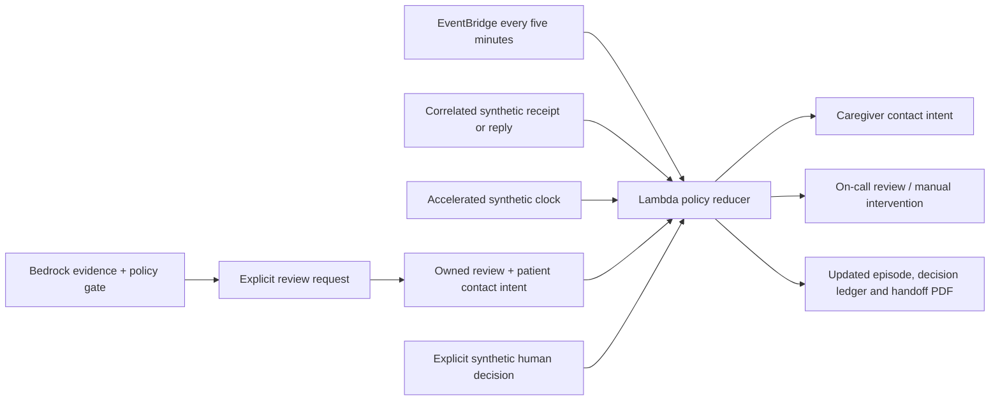

# Accountable handoff coordination

The model interprets synthetic evidence. A separate **deterministic policy controller** coordinates permitted operational actions. It is not autonomous medical judgment, a managed AgentCore deployment, or an independent collection of model-planning agents.

## What actually runs

Opening a clinical review request creates a unique coordination run, owned tasks, deadlines and durable contact intents in the same DynamoDB episode document. EventBridge invokes the Lambda backend every five minutes. The worker loads current state and evaluates the same reducer used by the accelerated demo clock. It does not need a browser tab, make a model request or send an external message.

## Operational policy, not clinical response times

| Trigger | Permitted action | What it cannot establish |
| --- | --- | --- |
| Review request opened | Assign treating-team review and patient contact tracking | A clinician has reviewed the case |
| Patient contact failure or two demo minutes without acknowledgment | Preserve the episode in one caregiver contact intent | A phone message was transmitted |
| Caregiver path also fails/times out | Assign manual contact to the care coordinator | Someone actually called the patient |
| Review remains unanswered after five demo minutes | Create one on-call review task | AI can replace the clinician decision |
| Further operational deadlines elapse | Retry once, then leave manual intervention with the duty supervisor | Work is complete just because retries stopped |
| Correlated caregiver concern | Attach the response to the existing run; open reassessment | Symptoms improved or teach-back was clinically verified |
| Explicit clinician decision / teach-back / follow-up | Reconcile the corresponding operational tasks and open the next required step | Real consultation, treatment or recovery occurred |

These short deadlines exist only to demonstrate operational behavior. Real urgency must never wait for the demo clock. Newly created escalation tasks get their own response window; a large clock jump does not skip all steps at once.

## Consistency and failure handling

- A global conditional DynamoDB lease serializes hosted workflow requests and scheduled ticks. A failed owner releases the lease or it expires after 75 seconds. Lease contention in the worker raises an invocation failure so it can retry.
- Episode ID, unique run ID, task ID and contact correlation ID must match. Reset/replay creates a new run and invalidates stale replies.
- An event ID has a persisted payload fingerprint. Identical repeats are ignored; reusing an ID with different content is rejected. This covers internal task effects, not an exactly-once external-delivery guarantee.
- Late receipts cannot reopen superseded/completed contact tasks. A contradictory failure receipt cannot erase a recorded simulated delivery. Delivery still does not prove acknowledgment.
- A late caregiver response reconciles pending manual-contact work but cannot clear a persistent clinical concern.
- Event history is bounded to 100 injected events per run; clock advances are bounded to one synthetic hour. Decision history retains the most recent 80 entries.
- Lambda asynchronous failures have one retry and an SQS failure destination. EventBridge target-delivery failures have two retries and the same queue. The queue retains records for one day. An operator must inspect and replay exhausted work; there is no claim of automatic DLQ recovery.

## Public judge walkthrough

1. On the overview, explore a recorded case and request clinician review.
2. Open **Review & follow-up**. Inspect task owners and the contact intent.
3. Inject patient delivery failure: a caregiver intent appears once.
4. Inject caregiver concern: it joins the same episode and opens reassessment.
5. Replay the same event: `DUPLICATE_IGNORED`; no duplicate task appears.
6. Advance six demo minutes: unanswered review moves to the on-call clinician. Expand **Why the controller acted**.
7. Record an explicit synthetic human review. Show teach-back and follow-up remaining separate requirements. A persistent concern remains unresolved.

All contact intents are `PREVIEW_ONLY`; receipts and caregiver responses injected by judges are synthetic. Hosted SES and phone sends remain disabled. The existing provider adapters are not wired into this new contact-intent outbox, so it does not claim a live two-way communications loop. Adding real dispatch needs consent, identity checks, provider correlation and delivery reconciliation.

## Verification and limits

See `submission/coordination-validation.json` for three public failure paths and `submission/coordination-worker-verification.json` for read-only AWS scheduler evidence. The verifier does not invoke the worker itself. The backend suite includes API persistence and adversarial policy tests.

There is no hospital SSO, clinical validation, EHR integration or measured readmission benefit. Synthetic owners are named roles, not authenticated clinicians or real staff assignments. The scheduler scans only the six configured fixture episodes; production scale requires an indexed due-work queue, tenant isolation, operational alarms and workload-specific service objectives.
