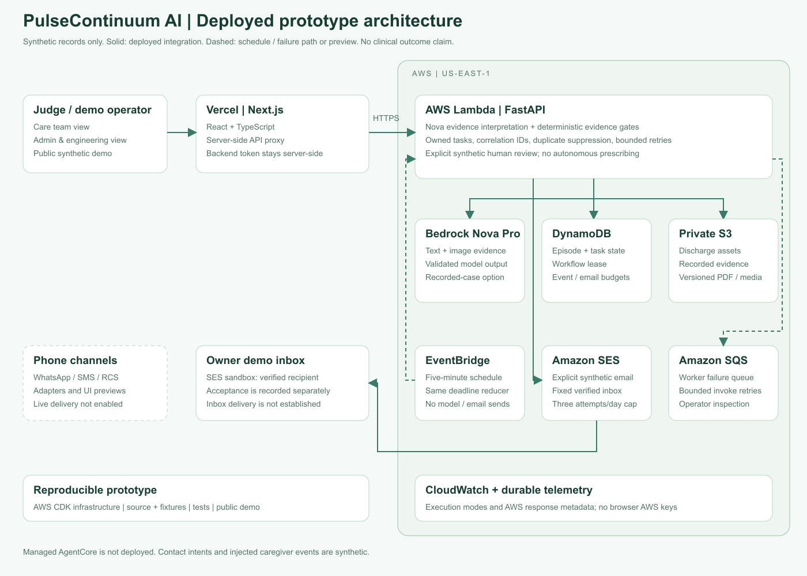

# Deployed architecture and enterprise roadmap

## Deployed prototype

The Next.js frontend runs on Vercel. Its server-side proxy uses a private service token to call FastAPI on AWS Lambda. Judges can switch between public synthetic care and engineering views; this is not hospital SSO or tenant isolation. Hosted event updates use polling.

Bedrock Nova Pro interprets text and medication-label images. Deterministic schema/formulary checks constrain permitted actions. DynamoDB persists episode state, coordination tasks, event fingerprints and shared attempt budgets. Private S3 stores discharge files, recorded evidence and content-versioned PDF/media artifacts.

EventBridge runs the deadline policy every five minutes. Lambda invocation retries and an SQS failure destination retain failed work for operator inspection. The explicit SES path is limited to a fixed verified demo inbox and a small daily attempt budget. Provider acceptance and inbox delivery are separate; current test acceptance is not claimed. Phone sends are not enabled.

Only synthetic cases are used. Managed AgentCore, hospital identity, EHR integration and validated clinical outcomes are not deployed capabilities. HMAC values demonstrate application payload integrity, not clinician signatures.

## Proposed enterprise SaaS design

[Enterprise reference architecture and design notes](ENTERPRISE_ARCHITECTURE.md)

The enterprise diagram adds verified tenant identity, tenant-aware authorization and storage, a SaaS control plane, durable Step Functions orchestration, production communication adapters, governance and operational resilience. Its BUILT / EXTEND / PROPOSED labels distinguish existing foundations from future work.
