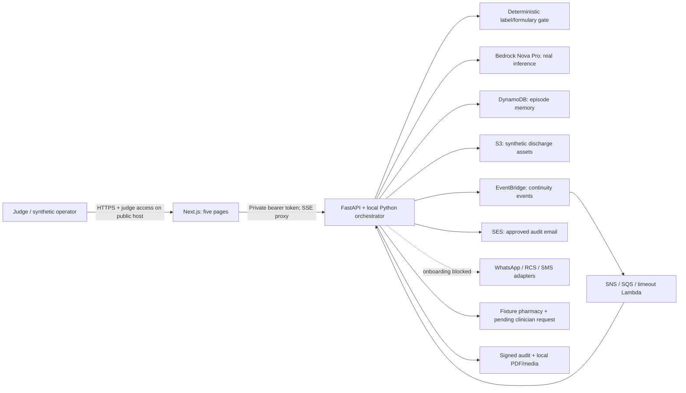

# Architecture and deployed boundaries

Solid service edges represent implemented adapters; verification evidence is described in the root VERIFICATION.md. Public hosting and its judge gate still require deployment verification. The existing application runs locally against the connected AWS stack. The frontend never receives the backend token or AWS credentials. SSE uses the server proxy. The optional judge middleware fails closed when `REQUIRE_JUDGE_AUTH=true` but credentials are absent.

The CDK stack provisions shared data/messaging infrastructure. The application orchestrator is not managed AgentCore. MCP servers expose tool definitions, while the current app calls their Python implementations directly. No managed safety policy or validated clinical risk model is claimed.

## Data lifecycle and trust

Only the six labeled synthetic cases are allowed in the hackathon demo. Uploaded PDF text and model output are untrusted. Explicit medication rows are required; invalid evidence fails to clinical review. A label match verifies only name and strength against the written formulary, not dose timing or clinical suitability. Model risk scores are unvalidated.

DynamoDB holds episode state; S3 holds uploaded discharge assets. Generated audit PDFs and media currently also depend on local disk. Cloud hosting must provide persistent disk or move these files to S3 before relying on restart durability. HMAC checks protect audit payload integrity but are not clinician signatures. No EHR, real pharmacy, emergency response or production clinical integration exists.

## Deployment cost boundary

Do not assume App Runner is available: AWS closed it to new customers on April 30, 2026. Candidate hosting must support an IAM execution role, HTTPS, private backend networking, durable artifacts and a cost bounded demo. Static AWS access keys must never be baked into containers. Public hosting is pending; the current $10 authorization covers initial integration/verification, not an unlimited recurring deployment.

## Profile boundary

Care team is the default experience and receives only allowlisted clinical API responses with raw traces and AWS identifiers removed. Admin & engineering receives the raw event stream and technical pages. A local Demo profiles selector enables presentation; on a secured host, care credentials cannot elevate to admin. See [access design](../docs/ACCESS_PROFILES.md).
