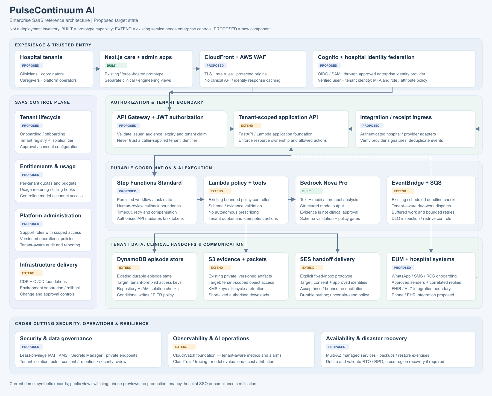

# Enterprise SaaS architecture — proposed target state

This is a design for evolving PulseContinuum into a multi-tenant SaaS offering. It is **not a claim that the enterprise services or controls are deployed**. Use `architecture-current.png` for the deployed hackathon architecture and this reference as a clearly labeled roadmap.

## Diagram legend

- **BUILT:** the named prototype capability exists; this does not certify enterprise readiness.
- **EXTEND:** the underlying service or foundation exists, but its depicted tenant, scale or operational controls require further work.
- **PROPOSED:** a new enterprise component or integration.

## Design decisions

1. Bind authenticated users to a verified tenant identity. Hospital federation, MFA and JWT authorization precede access to clinical APIs. Never trust a browser-supplied tenant identifier as authorization. AWS distinguishes tenant isolation from ordinary authentication: [SaaS identity](https://docs.aws.amazon.com/whitepapers/latest/saas-architecture-fundamentals/saas-identity.html), [tenant isolation](https://docs.aws.amazon.com/whitepapers/latest/saas-architecture-fundamentals/tenant-isolation.html).
2. Separate shared tenant lifecycle, entitlements, metering and platform administration from the patient-workflow data plane. A hospital tenant contains many users and is not equivalent to a user account. See [AWS SaaS core services](https://docs.aws.amazon.com/whitepapers/latest/saas-architecture-fundamentals/core-services.html).
3. Introduce Step Functions Standard for durable orchestration and human-review waits. An authorized backend mediates task-token completion; task tokens are not exposed as unrestricted approval links. See [callback integration patterns](https://docs.aws.amazon.com/step-functions/latest/dg/connect-to-resource.html).
4. Preserve the current separation between model interpretation, deterministic evidence/policy checks and explicit human clinical decisions. Adding an orchestration service must not grant a model medical decision authority.
5. Enforce tenant scope in repositories and service permissions, including DynamoDB access patterns and S3 object access. Tenant-prefixed keys alone are partitioning, not proof of isolation; negative cross-tenant tests and policy enforcement are required.
6. Keep communication intents durable and distinct from provider acceptance, recipient delivery and human acknowledgment. Production communication requires consent, approved senders, authenticated receipts, bounded retries and reconciliation of uncertain outcomes.
7. Define operational service objectives, isolation tiers, capacity and recovery requirements before promising multi-region availability or clinical service levels. Backups and restore exercises precede any RTO/RPO claim.

## Current boundaries

The deployed demo uses Vercel, Lambda, Bedrock, DynamoDB, private S3, EventBridge and SQS. It has an explicitly bounded SES demo path; current email acceptance must be checked separately. Phone channels and hospital integrations remain previews/proposals. Public profile switching is a demo convenience, not tenant isolation or hospital SSO. No compliance certification, clinical validation or production patient deployment is claimed.
